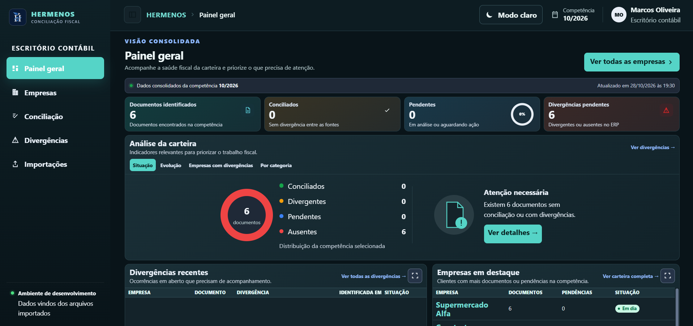
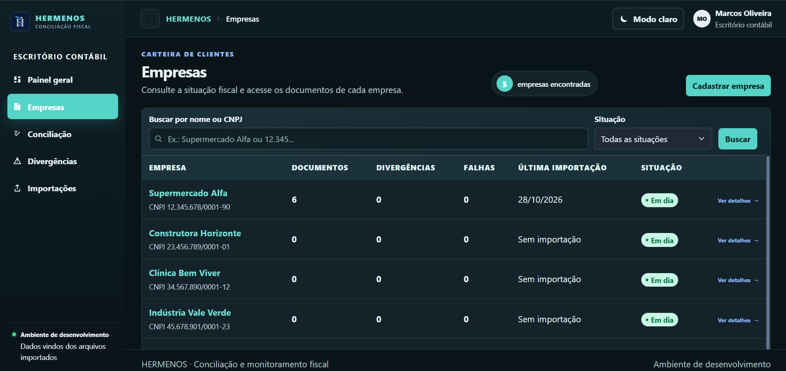
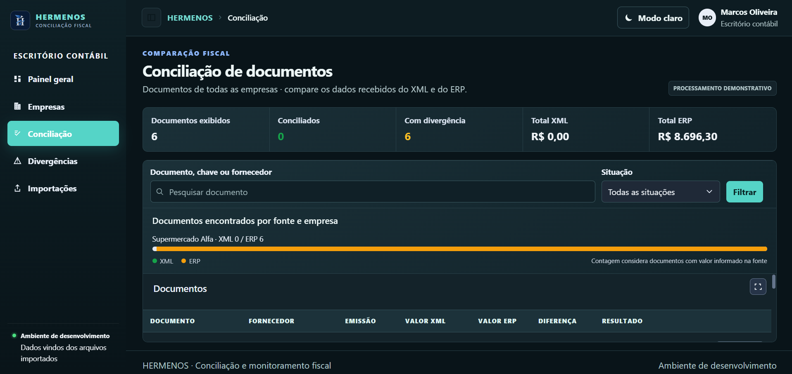
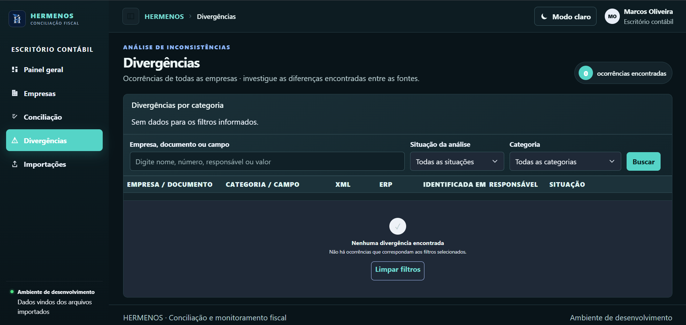
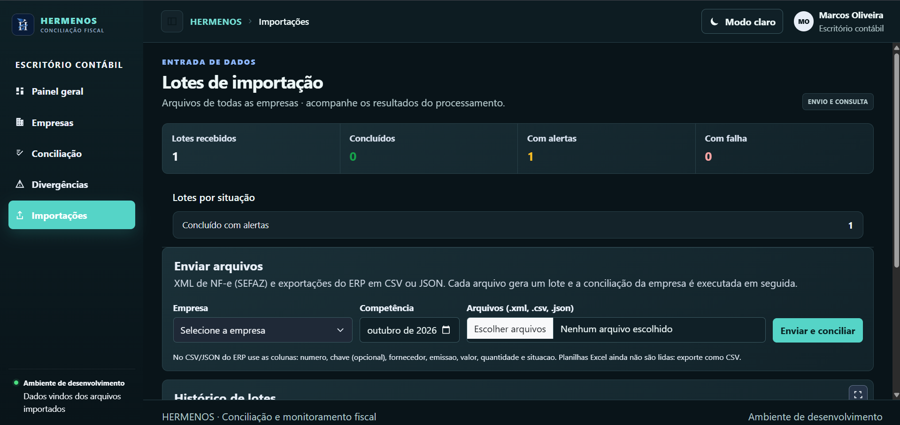

# Hermenos

Sistema de conciliação fiscal e operacional desenvolvido com **ASP.NET Core 8 MVC**, **Entity Framework Core 8** e **PostgreSQL**, voltado à importação e conciliação de arquivos XML de NF-e e dados exportados de sistemas ERP.

> Este repositório apresenta o projeto, suas telas, o modelo de dados e as decisões técnicas. O código-fonte está em um repositório privado.
>
> Quer avaliar o código? Entre em contato pelo [LinkedIn](https://linkedin.com/in/marcos-oliveira-033623350) para solicitar acesso.

## Visão geral

O Hermenos busca facilitar a conferência de informações fiscais e operacionais provenientes de diferentes fontes, auxiliando na identificação de divergências entre documentos fiscais e registros de ERP.

## Telas

| Painel Geral | Empresas |
|---|---|
|  |  |

| Conciliação | Divergências |
|---|---|
|  |  |

| Importações |
|---|
|  |

## Funcionalidades

- **Importação de dados:** processamento de arquivos XML de NF-e e dados exportados de sistemas ERP.
- **Conciliação de dados:** comparação das informações provenientes das fontes importadas.
- **Identificação de divergências:** apoio à identificação de inconsistências entre os registros conciliados.
- **Organização dos resultados:** apresentação das informações processadas para facilitar a análise.
- **Persistência de dados:** armazenamento das informações utilizando PostgreSQL e Entity Framework Core.

## Tecnologias

C# · ASP.NET Core 8 MVC · Entity Framework Core 8 · PostgreSQL · XML · JSON · Razor · JavaScript · CSS

## Autor

**Marcos Fernandes Costa Oliveira**

Estudante de nível técnico em Desenvolvimento de Sistemas — SENAI.

---

© 2026 Marcos Fernandes Costa Oliveira. Todos os direitos reservados.
